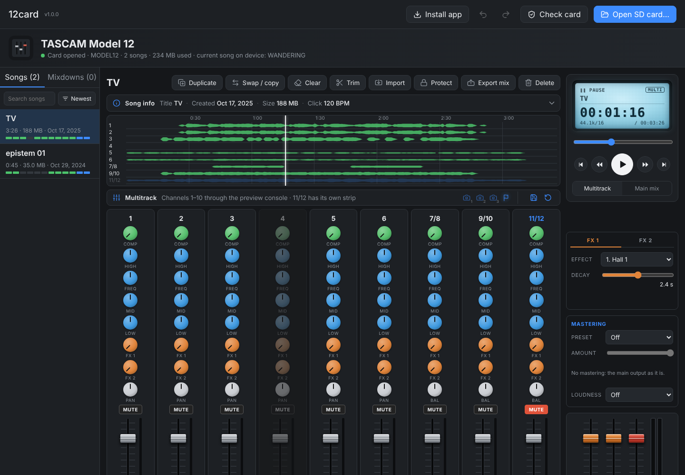
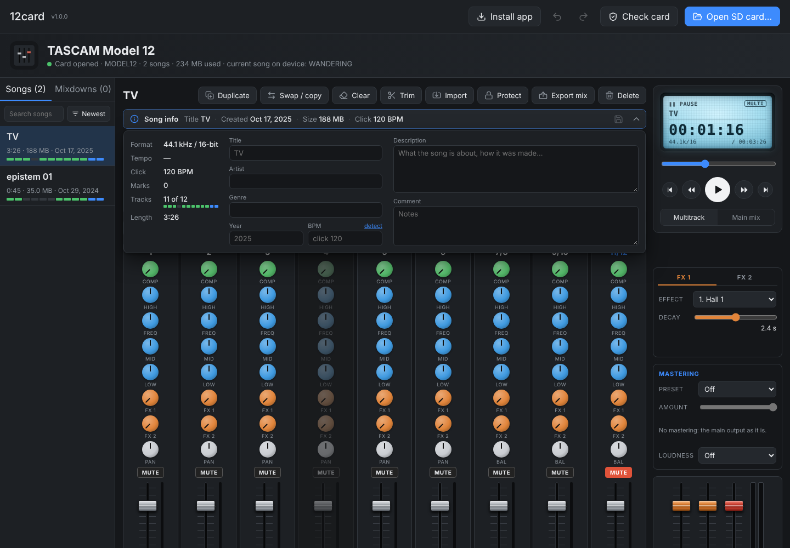
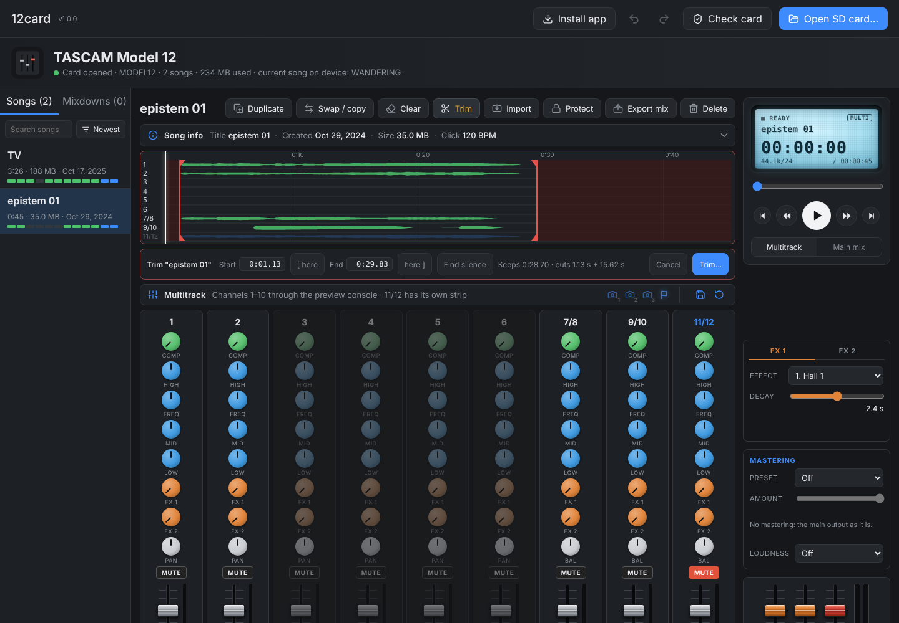

# 12card

**Manage the songs on your TASCAM Model 12 SD card from your computer:** listen to every track, mix them in a preview console, trim silence, swap and clear tracks, import audio, export the stereo mix, and download a mastered FLAC. All in the browser, without uploading anything.

12card keeps your card the way the Model 12 writes it. Every change produces files in the unit's own format, is checked byte for byte, and can be undone. The only things it adds are a `SETTINGS` folder (song info and mixes) and, if you choose, a `cover.jpg`.

12card is a hobby project for the **Model 12** only. It is not made by or affiliated with TASCAM. The idea started from [this Reddit post](https://www.reddit.com/r/TascamModel_12_16_24/comments/1xstd1f/wanted_a_better_way_to_manage_the_model_12_sd/).

## Highlights

- **Listen:** all 12 tracks with a preview mixer (compressor, EQ, two effect sends, pan, mute/solo), the recorded main mix, and the mixdowns in `MUSIC`. A track overview shows where each track has sound and where the marks are.
- **Edit tracks** like the unit's TRACK SWAP / CLEAR / IMPORT: swap 11/12 to 7/8 and clear the rest for a bounce, or import WAV, FLAC, MP3 and more into empty tracks (with optional loudness normalising).
- **Trim:** cut silence off the start and end of a song, all tracks at exactly the same sample, keeping the unit's format and the marks.
- **Songs:** rename, duplicate, protect, delete and create songs, with undo/redo for everything except delete.
- **Song info:** title, artist, genre, year, BPM (with tempo detection), description and a cover, stored next to the songs and written into the FLAC tags of downloads.
- **Export:** the stereo mix to `MUSIC`, identical to the unit's own export, or a FLAC download of the recorded mix or your own preview mix, with mastering presets and loudness targets (−16, −14 or −10 LUFS).
- **Check card:** reads every byte and reports unreadable files, missing tracks and leftovers, the first sign of a failing card.

| Song info | Trim |
|---|---|
|  |  |

## Before you start: keep a copy of your card

12card checks every change it makes, but it's your music. **Copy the whole card to your computer before you edit anything** (the app asks you to confirm this once per session), and always eject the card properly before taking it out.

## Getting started

You need **Chrome**, **Edge**, **Vivaldi** or **Brave** (with `brave://flags/#file-system-access-api` turned on) to make changes. Firefox and Safari can open a card read-only.

1. Download 12card (on GitHub: **Code → Download ZIP**) and unpack it anywhere.
2. Put the Model 12's SD card in your computer.
3. Open `index.html` in Chrome: double-clicking it is enough. No install and no server needed, on Linux, Mac and Windows.
4. Click **Open SD card…** and pick the card (on Linux, for example, `/media/<you>/MODEL12`; on a Mac `/Volumes/…`; on Windows the card's drive) or a folder that holds a copy of it.
5. Click a song and press play. **Check card** is a good first step on a card you haven't checked before.

Your audio never leaves your computer: 12card only reads and writes the card on your own machine.

## More ways to run it

### Install it as an app (PWA)

The app can be installed so it gets its own window, an icon in your app menu, and starts without a network. Browsers only allow this from a web address (`https://…` or `http://localhost`), not from a double-clicked file. Two ways:

**On this computer (simplest):**
1. Run `./serve.sh` in the app folder (it uses Python, which Linux has built in).
2. Open **http://localhost:8765** in Chrome.
3. Click **Install app** in the top bar (or the install icon in Chrome's address bar).

After that, start it from your app menu. It works offline too: the app's own files are cached, so `serve.sh` only needs to run when you want to pick up a new version. Always use the same address and port, because the installed app belongs to `localhost:8765`.

**From anywhere:** put the app folder on a static host such as GitHub Pages. Then it's an `https://` address that you can install on any computer. Your audio is never uploaded: the app only reads the card on your own machine.

**Updates:** when a new version is available, the app shows **A new version of the app is ready → Update now**. It waits for you to click it, and never updates in the middle of a card operation. The version number is shown next to the title.

The badge next to the title shows **Editing on** when the app can write to the card, and **Read-only** otherwise:
- **Chrome is the recommended browser for renaming.** It moves the audio files on the card directly, so a rename takes a moment. Chrome refuses to move some file types (such as `song.sys`); the app copies those few small files instead and checks them byte for byte.
- **Brave:** turn on `brave://flags/#file-system-access-api` and restart Brave to rename songs. Without it, Brave can still read and play everything. Brave refuses to move any file, so the app copies the whole song to its new name, checks every byte, then deletes the old folder. That's slower and writes the whole song to the card again.
- The version number next to the title shows which version is running. If it doesn't change after an update, reload with Ctrl+Shift+R.
- **Firefox and Safari:** read-only.

## What it does

**Browse and listen**
- Song list: length, size and creation date on one line, with a bar showing which tracks are used. The sort button opens a menu: date, name, size or length, ascending or descending (remembered in the browser).
- Player: to start, previous mark, play/pause, next mark, to end. Double-click play to start from the beginning. The play button glows while playing. A pin marks the current song (the last one loaded on the unit), a lock marks protected songs; hover for the meaning. Search and sort.
- The card bar shows the total space the files on the card take up.
- The buttons next to the song name (Duplicate … Delete) show icons only when the window is too narrow for their labels; the labels come back when there's room. Hover for what each does.
- **Multitrack** (where a song opens) plays tracks 1–10 through a preview mixer: compressor, 3-band EQ, two FX sends, pan, mute/solo, faders. **Main mix** plays the recorded main mix (TR11/12) for a quick listen. The song, the console and the right-hand column (player, effects, mastering, main faders) form one workspace that scrolls as a whole; the main faders always sit on the same line as the channel faders.
- **Effects:** two of them, **FX 1** (starts as Hall 1) and **FX 2** (starts as Delay 1), in one box with a tab for each (a dot on a tab means a channel sends to it), each with the same 16 types as the Model 12 (Hall, Room, Plate, Studio, Live, Delay, Ping Pong, Chorus, Flanger and the Delay/Chorus + Hall combinations), each with one parameter: DECAY for reverbs, TIME for delays, RATE for chorus/flanger.
  - Delay times are note values (1/16 … 1/2) locked to the song's tempo: the BPM from Song info, or else the click tempo from the card. You can type another tempo; "song" switches back.
  - The orange **FX 1** and **FX 2** knobs on each channel send it to the effects (after the fader; MUTE cuts the sends too). The **FX 1** and **FX 2** faders next to MAIN set the returns, each with its own mute.
  - **Clipping:** when the main output goes over 0 dBFS, the amount shows under MAIN (e.g. "4.0 dB ⚠"). The warning flashes faster the harder it clips, stays for 4 seconds after the last clip, and a click clears it.
  - The effects are approximations made in the browser, to hear what a type does before dialling it in on the unit. They're not TASCAM's own algorithms.
- **Readout:** hover over a knob or fader and a small backlit display shows its name and value (faders in dB). It stays up while you turn or slide, even when the pointer leaves the control.
- **Switched off:** in Main mix the recording on 11/12 plays exactly as recorded, so the channel strips and effects are greyed out and can't be touched. A strip for an empty track is switched off too. In Multitrack, 11/12 is a normal channel (muted at the start, as it usually holds the mix of 1–10).
- **Snapshots** (camera icons 1–3 on the Multitrack bar): click an empty one to remember the console as it is, click a lit one to go back to it; Shift+click or right-click takes it again. The flag goes back to the mix as it was when you opened the song. The one the console is on now glows. Snapshots last until you open another song.
- **Mastering** on the main output gives the final sound some character: Punch, Crystal stereo, Ambience, Vocal presence, Kick, Stereo enhance, Nature, Sixties, Seventies, Analog, Vinyl and Tape. **AMOUNT** blends it with the unmastered sound. Every preset ends in a limiter, so it doesn't clip. You hear it on everything you play (multitrack, main mix, mixdowns) and it's in the My mix download; card exports stay exactly like the unit's own. The preset is saved with the song's mix.
  - **LOUDNESS** sets the loudness of the My mix download: −16 LUFS (podcasts, Apple Music), −14 LUFS (Spotify, YouTube) or −10 LUFS (loud). The app measures the mix (EBU R128), turns it up or down, and a look-ahead limiter keeps the peaks at −1 dBFS.
  - Presets are plain chains of building blocks (EQ, compressor, stereo width, saturation, room, wow and flutter, noise, limiter) in `config/mastering.js`. If one doesn't sound right, change its numbers there, or copy it to make a new one; no code changes needed.
- **Overview** above the console: one lane per channel strip showing where each track has sound, the marks (yellow) and the play position. Click or drag in it to jump. Press **T** (or click it, or Tab to it) and use the keyboard; **Escape** lets go: **Home**/**End** to the start/end, **←/→** one second, **Shift+←/→** ten seconds, **Ctrl+←/→** (⌘ on a Mac) to the previous/next mark.
- **Marks** are set on the Model 12 itself; 12card shows them (overview, seek bar) and jumps to them, but doesn't change them.
- The Mixdowns tab plays the files in `MUSIC/`.

**Check card**
- Reads every byte of every file and lists any file the card can't read: the first sign of a failing card.
- Also flags songs with missing track files, and a "current song" setting that points to a song that no longer exists.

**Rename (with undo/redo)**

Rename works like the Model 12 itself does:
- It renames the song folder and its 12 track files. Nothing inside the files changes, and the mixdown in `MUSIC/` keeps its old name.
- Case-only changes (TV → tv) go through a temporary name. The card ignores upper/lower case, which is why the unit shows "File Error" for these.
- Renaming the current song also updates its name in `tascam_m.sys`, using the same bytes the unit writes when it loads a song.

It refuses:
- names over 11 characters, or with characters the card can't store
- a name that matches another song when case is ignored
- protected songs, and songs with problems (run Check card first)

Safety:
- Before the first change in a session, it asks you to confirm you have a copy of the card.
- If anything fails halfway, moved files are moved back and copies are deleted, so the song is left exactly as it was. Originals are only deleted after the new folder has been checked.
- After every rename, it checks the result (names and sizes) before removing the old folder.

**Track editing (like chapter 7 of the Model 12 manual, with undo/redo)**

Every track action works on single tracks 1–12 and on the pairs 7/8, 9/10 and 11/12, listed in the manual's order.

- **Swap / copy:**
  - **Swap** (the default) trades two tracks or two pairs, like TRACK SWAP. Nothing is lost. In Chrome it is three file renames; in Brave the file contents are swapped and checked.
  - **Copy** puts one track's audio onto another and replaces the target.
- **Clear:** tick the tracks to empty, like TRACK CLEAR. "Tick all except 7/8" sets up the bounce from the manual in one go: swap 11/12 to 7/8, then clear the rest. A cleared track is written exactly like the unit's own empty tracks (5,548 bytes).
- **Trim:** cut silence (or anything else) off the start and end of a song. Clicking Trim puts two red edges on the track overview and finds the sound by itself: the first and last moment louder than −60 dBFS on any track, plus 0.25 s before and 1 s after. Drag the edges, type the times, or press `[` and `]` to put them at the play position; play the song to check. "Trim…" shows what will happen and then cuts every track with audio at exactly the same sample. Each track keeps its own Model 12 header (only the sizes change) and its audio is copied sample for sample at the recorded bit depth; empty tracks are not touched. Marks move with the music (song.sys and the tracks' cue chunks); marks in the cut part are removed. The new tracks are written and checked first, then swapped in; the originals are moved to `SETTINGS/trim-undo/` so ↶ can put them back, and 12card offers to delete them the next time you open the card. Don't trim tracks in another editor: Audacity and the like write their own WAV header, and exporting stereo or 16-bit makes the tracks unreadable for the song.
- **Import:** puts an audio file on an empty track, like TRACK IMPORT, either from the card's `MUSIC` folder or straight from your computer.
  - Formats: WAV, FLAC, MP3, M4A/AAC, OGG and Opus (everything except WAV is decoded by the browser).
  - Mono goes on a single track, stereo on a pair, and like on the unit the targets must be empty.
  - **FLAC is exact:** at the song's rate and bit depth, the track gets exactly the samples that were recorded, the same as importing the WAV.
  - **Other sample rates are converted** to the song's rate (the Model 12 itself refuses these). The dialog says so.
  - 16/24/32-bit and 32-bit float audio is converted to the song's bit depth (with dither when going down to 16-bit). MP3, AAC, OGG and Opus are lossy: the track is only as good as the file.
  - **Normalise the level:** the dialog measures the file's loudness and offers to bring it to −23 LUFS, about the level of tracks recorded on the Model 12 (peaks no higher than −3 dBFS). It's ticked by default for loud files such as finished masters (louder than −18 LUFS). With it on, the audio is converted rather than copied exactly. The levels are in `config/mastering.js`.
  - The whole file is decoded in memory first (about 200 MB for a 10-minute stereo file).
- **Downloads are always FLAC; exports to the card are always WAV** (like the unit's own). FLAC is lossless, about half the size of WAV, and its tags and artwork show up in practically every player. The app has its own FLAC encoder (`flac.js`; browsers can't write FLAC): checked bit for bit against ffmpeg on 100 kinds of test signal and on real recordings, with a matching MD5, and within a few percent of ffmpeg's file size. A 4-minute song takes about 5 seconds. The recorded mix as FLAC holds exactly the samples of 11/12 at the song's bit depth (`<song>_2-MIX_01.flac`); My mix is 24-bit (`<song>_MIX_APP.flac`).
- **Export mix** has two choices:
  - **The recorded mix:** the main mix on 11/12 as one stereo WAV, like STEREO MIX EXPORT, named `<song>_2-MIX_01.wav`. To the card or as a download (details below).
  - **My mix:** tracks 1–10 (and 11/12 if you unmuted that strip) through the app's console and effects, exactly as you hear them: faders, pan, EQ, compressor, mute/solo, both FX sends, the effects, their returns and the main fader. Rendered offline, faster than real time (about 25 s for a 4-minute 10-track song on a slow machine), as a **24-bit** stereo FLAC at the song's rate, named `<song>_MIX_APP.flac`. **Download only**: the card stays as the Model 12 made it. If the mix would clip, the app says by how much and offers to bring it down to −1 dBFS. The effect tail is kept. The compressor, EQ and effects are the app's own, so the result sounds like the app's preview, not like the same settings on the unit.
  - Saved in `MUSIC` on the card (an existing file is replaced, as on the unit), or downloaded to your computer. Downloading also works in read-only mode.
  - **Artwork:** every downloaded mix gets a cover made for that song (1400 × 1400, embedded as the FLAC front picture): the app's three-fader logo with the faders set to the song's own levels (tracks 1–6, 7–10, and the main mix in red; the loud part of the song, −48 dB at the bottom to −6 dB at the top), and the title, artist and year underneath. The export dialog shows it and redraws it as you edit the info; click the thumbnail to see it full size. A `cover.jpg` or `cover.png` in the root of the card overrides it. A checkbox leaves the artwork out. (`icons/cover.jpg`, made by `tools/make_icons.py`, is the fallback if a cover can't be drawn.)
  - Exports to the card have no tags, exactly like the unit's own. Downloads get the song info as FLAC tags (title, artist, genre, BPM, description, comment, and DATE: the recording date from `song.sys`, e.g. 2025-10-17) and the cover as front picture.
- **Trim the silence** (on by default, downloads only): the Model 12 always records some silence before and after the music. The download starts ¼ s before the first sound and ends 1 s after the last (sound = louder than 48 dB below the loudest moment). The recorded mix is only cut, so the samples that remain are still exactly the card's. The export dialog shows the info so you can add or change it, and can save it as the song's info.
  - Files over 2 GB are split into `_02`, `_03` and so on.
  - Tested: the export is byte for byte identical to the unit's own export of the same song, apart from the export time.

Safety:
- Every write is checked byte for byte or by checksum.
- If something fails halfway, everything already written is put back.
- Replaced or cleared audio stays in memory until you close the app, so ↶ can put it back.

**Song info**
- Under the song name is one **Song info** bar showing title, artist, created date, size and tempo. Click it and the card slides open **over** the overview and console (nothing moves), with the facts (format, tempo, click, marks, tracks used, length) on the left, title, artist, genre, year and BPM in the middle, and **Description** and **Comment** on the right. The save icon on the bar lights up when there's something to save. Click the bar again, click elsewhere or press Escape to fold it away (with unsaved changes it stays open).
- **Artist and genre** suggest what's already on the card as you type (type "b" for "ben van 't ende"). An empty field is filled in with the artist or genre used most; it only counts as a change once you edit or save it.
- The fields hold title, artist, genre, year, BPM and comment.
- **Tempo:** the Model 12 doesn't store the tempo you play at, only its metronome (click) setting, shown as "Click 120 BPM". Put the real tempo in **BPM**, or click **detect** to estimate it from the recording (the main mix on 11/12, or tracks 1–10). Detect fills in a suggestion; Save keeps it. It can be off by a factor of two on some material, so the message offers the half and double tempo too. Tested on WANDERING (86 → 86.1) and TRAVELOGUE (119 → 119.0).
- **Save also sets the click tempo** on the unit to the BPM, rounded to a whole number (one byte in `song.sys`, 20–250 BPM; not for protected songs). Undo puts the old click tempo back.
- The delay effects follow the BPM when it is set, otherwise the click tempo. Downloads carry the BPM as a tag.
- **Where it's stored:** a `SETTINGS` folder in the root of the card, one JSON file per song (`SETTINGS/<song>.json`: the song info and its mix) plus `SETTINGS/_card_settings.json` (the card's artist and genre lists). Plain text you can read and edit. The Model 12 ignores the folder. A card with an older `metadata.txt` is converted on the first save, after which `metadata.txt` is removed.
- Renaming a song takes its settings along. Saving info can be undone.

**Rename and duplicate**
- Click the song's title to rename it in place: type, Enter to apply, Escape to cancel. Invalid names are explained under the title. The first rename in a session still asks you to confirm you have a copy of the card.
- **Duplicate** first explains what it does, then copies the whole song (all files, renamed like the unit does) with its settings, so you can edit the copy and keep the original as it is. The name gets `01` (or the last two characters become `01` when the name would be over 11 characters); `02`, `03` and so on if that name exists. Protected songs can be duplicated. ↶ removes the copy.

**Delete**
- Deletes a song from the card for good: the song folder with all its files, and its settings. You have to type **DELETE** to confirm, because it can't be undone (↶ won't bring it back). Mixdowns in `MUSIC/` stay. Protected songs can't be deleted.
- If it was the current song on the Model 12, the unit's current song becomes the newest remaining song (the same change the unit makes when you load a song).

**Protect / Unprotect**
- Sets the same protect flag as SONG PROTECT on the unit (one byte in `song.sys`). A protected song can't be renamed or edited, on the unit or in the app, until you unprotect it. Handy after you've set up a song with swaps and clears. Undo works.

**Import into a new song**
- In the Import dialog, choose "Into a new song" to create a song with the audio on it, e.g. a backing track to play along with. The name is suggested from the file (max 11 characters).
- The new song gets 12 empty tracks exactly like the unit's, and its settings (`song.sys`) are copied from an existing song with the same sample rate, with protection off, no marks, tempo 120 and today's date. ↶ removes the song again.
- Not yet confirmed on the unit: test once that the Model 12 loads a song made this way.

**Mixes are saved per song.** A moment after you change the console, its settings (both effects included; solo is not stored) are stored in the song's `SETTINGS` file. Opening the song brings its mix back; a song without its own mix opens with the factory settings. Two icons on the right of the Multitrack bar:
- **Save light:** flickers red while saving, green when saved.
- **Reset** (↺): forget this song's mix and go back to the factory settings. Undo brings it back.

**Mixer:** 11/12 has its own strip (blue label). It starts muted because it usually holds the mix of 1–10.

Keyboard: space = play/pause. Knobs: drag up/down (hold shift for fine control), scroll wheel, or arrow keys. Faders: drag, or use the mouse wheel (hold shift for bigger steps). The FX 1, FX 2 and Mastering sliders work with the mouse wheel too (1 % a step, shift for 5 %; stepped settings such as delay note values jump to the next one). Double-click a knob or fader to reset it; faders go back to 0 dB. The 0 dB mark lights up when a fader reaches it, and a fader snaps to 0 dB while you drag past it.

A "Read-only" badge appears next to the version only when nothing can be changed (Firefox, Safari, Brave without the flag). After opening a card, a tip suggests running **Check card** once; "Don't show again" hides it for good.

**Always eject the card properly before taking it out.**

## When changes fail: a read-only card

Before every change the app writes and removes a tiny test file (`MTR/tmmtmp_probe.bin`). If that fails, nothing is touched and the app says the card is read-only. The usual causes:

- the **lock switch** on the side of the SD card is on LOCK;
- **Linux mounted the card read-only** after finding a file-system error. `mount | grep MODEL12` then shows `ro`, and `sudo dmesg | grep -iE "fat|mmc" | tail` says why. Eject the card; if it keeps happening, run `sudo fsck.vfat -a /dev/sdX1` (your card's device) with the card unmounted, or copy everything off, format in the Model 12 and copy MTR and MUSIC back.

If only some files are marked read-only (the card itself is writable), the app writes the new version next to the file (`tmmtmp_new_…`), checks it, removes the original and gives the new file its name. A swap whose renames are refused falls back to swapping the file contents. **Check card** also tests which files can be changed: it opens each file for writing and cancels straight away (the file is not touched), then lists read-only files per song, with how to clear the attribute. The first time, Chrome asks for permission to edit files on the card. A leftover `tmmtmp_…` file after a crash is reported there too.

## Files

| File | What it does |
|---|---|
| `config/card-model12.js` | The card format as JSON: number of tracks, the main mix on 11/12, folder and file names, byte positions in `song.sys` and `tascam_m.sys`, the track groups for Swap/Clear and the console strips. |
| `config/mixer.js` | The console as JSON: knob rows, strip defaults and the two effects a song starts with. |
| `config/mastering.js` | Mastering presets, loudness targets and the import normalise level, as JSON. |
| `trackmap.js` | The song overview above the console (keys and marks are handled in `app.js`). |
| `master.js` | The mastering building blocks, the look-ahead limiter and loudness normalisation for downloads. |
| `loudness.js` | Loudness (LUFS, ITU-R BS.1770 / EBU R128) and peak measurement. |
| `model12.js` | Card format: reads `song.sys`, `tascam_m.sys` and WAV headers; name rules; card checks. No browser code, so it can be tested with Node. |
| `cardio.js` | Everything that writes to the card: rename, swap, copy, clear, import, export (all with rollback), plus the full-read card check. |
| `player.js` | Streaming 12-track player and preview mixer (Web Audio). |
| `fx.js` | The 16 effect types and the FX bus (send → effect → FX return); the player runs two. |
| `app.js` | The interface (including install and update handling). |
| `icons.js` | The icon set (shapes from Lucide, ISC licence). |
| `manifest.webmanifest`, `sw.js`, `icons/` | The installable-app parts: app description, offline cache (service worker), app icons. |
| `serve.sh` | Serves the app on http://localhost:8765 so it can be installed. |
| `tools/make_icons.py` | Regenerates the app icons. |
| `tools/screenshots.py` | Makes the README screenshots from a card copy: `python3 tools/screenshots.py "<card copy>" "<song>" ["<song to trim>"]` (needs Playwright) |
| `index.html`, `style.css` | Page and styling. |
| `tests/model12.test.js` | Parser and name-rule tests: `node tests/model12.test.js "../SD CARD 03"` |
| `tests/fx_test.py` | Renders every effect offline and checks echo timing, ping-pong sides and reverb lengths: `python3 tests/fx_test.py` |
| `tests/pwa_test.py` | Checks that Chrome sees the app as installable, that it starts offline, and that updates work: `python3 tests/pwa_test.py` |
| `tests/export_vs_unit.test.js` | Compares the app's stereo export with the unit's own: `node tests/export_vs_unit.test.js "../SD CARD 01" "epistem 01" EPISTEM_01_2-MIX_01.wav` |
| `tests/loudness.test.js` | Loudness meter, limiter and normalisation: `node tests/loudness.test.js` |
| `tests/edit_e2e.py` | Rename/undo/rollback/check-card test in headless Chrome, on a fake card: `python3 tests/edit_e2e.py` (needs Playwright) |
| `tests/trim_e2e.py` | Trim song test: Find silence, a sample-exact cut with headers and marks kept, undo/redo and the clean-up offer, plus the FX/Mastering slider wheel: `python3 tests/trim_e2e.py` |

The `config/*.js` files are plain JSON wrapped in one line of JavaScript, so they also load when `index.html` is opened straight from disk (browsers don't let a local page read `.json` files). Edit them like JSON: double quotes, no trailing commas.

**If the window goes dark:** a dark screen with a box is 12card working on the card. If nothing happens there for 30 seconds (for instance because the card dropped off), it says so and offers **Reload 12card**; every change is checked, so the card is never left half-done. A completely black or blank window means the browser page itself stopped: press Ctrl+R (or close and reopen the app).

**When you change the app:** bump the version in `sw.js` (`VERSION`) and in `index.html` (every `?v=` and the title) to the same value. `tests/pwa_test.py` checks that they match. Otherwise installed copies keep the old files.

What 12card knows about the card format (song.sys, track headers, marks, exports) is in [`docs/model12-card-format.md`](docs/model12-card-format.md).

## Debugging

In the browser console:
- `app.state` and `app.player` give access to the loaded card and the player.
- `app.history` holds the undo/redo list.
- The rename steps are logged to the console.

## Licence

MIT: see [LICENSE](LICENSE). Use it, change it, fork it (a Model 16 or 24 version would be welcome). The icons are from [Lucide](https://lucide.dev) (ISC licence). TASCAM and Model 12 are trademarks of TEAC Corporation; 12card is not affiliated with them.
